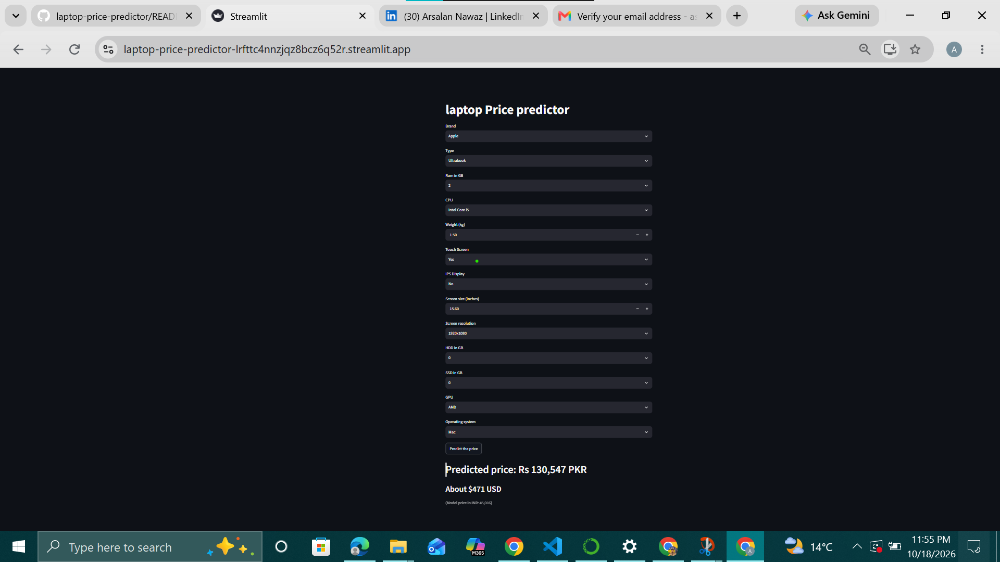

# Laptop Price Predictor

A machine learning web app that predicts a laptop's price from its specifications. The model is a tuned Random Forest inside a scikit-learn Pipeline, and the app is built with Streamlit.

**Live app:** https://laptop-price-predictor-lrfttc4nnzjqz8bcz6q52r.streamlit.app/)



## What it does

You choose the laptop's specs (brand, RAM, CPU, storage, screen, and so on) and the app shows the predicted price in **PKR** and **USD**.

## Inputs used by the model

| Feature | Type |
|---|---|
| Company, TypeName | Categorical |
| Ram, Weight | Numeric |
| Touchscreen, IPS | Yes / No (0 or 1) |
| ppi (pixels per inch) | Calculated from screen size and resolution |
| Cpu brand, Gpu brand, os | Categorical |
| HDD, SSD | Storage in GB |

## How it works

1. **Data cleaning and feature engineering:** extracted features such as touchscreen, IPS panel, ppi, CPU brand, GPU brand, storage type and size, and operating system.
2. **Target transformation:** `Price` was right-skewed, so the model is trained on `log(Price)` and the prediction is converted back with `exp`.
3. **Preprocessing:** a `ColumnTransformer` with `OneHotEncoder` for the categorical columns, the numeric columns pass through unchanged.
4. **Model:** a `RandomForestRegressor` inside a `Pipeline`, so the encoding and the model are saved and used together.
5. **Hyperparameter tuning:** `RandomizedSearchCV` with 5-fold cross-validation on the training data only.
6. **Deployment:** the saved pipeline is loaded by a Streamlit app and hosted on Streamlit Community Cloud.

## Results

| Metric | Score |
|---|---|
| Cross-validation R2 (log price, training data) | 0.873 |
| Test R2 (log price) | 0.8915 |
| Test MAE (log price) | 0.1576 (about 15% average error) |
| Test R2 (real price) | 0.823 |
| Test MAE (real price) | 9,022 |

Random Forest and XGBoost gave similar results in early tests (R2 around 0.87 to 0.88), and Random Forest was tuned and used for the final app.

## Currency conversion

The training data has prices in **Indian rupees (INR)**. The app converts the prediction using fixed approximate rates:

- 1 INR = 2.9 PKR
- 1 USD = 277 PKR

These rates were set in October 2026. You can change `INR_TO_PKR` and `PKR_PER_USD` in `app.py`.

## Limitations

- **Older data:** the dataset is from an earlier period and from the Indian market, so predicted prices will usually be **lower** than current Pakistani market prices, even after conversion.
- **Limited features:** the model does not see the exact CPU model or generation, the exact GPU model, build quality, or battery size, which all affect price.
- **Small dataset:** with limited data, rare spec combinations are predicted less accurately.
- **Fixed exchange rates:** conversion rates are typed into the code and are not updated automatically.

## Future improvements

- Retrain on current Pakistani laptop listings.
- Split CPU and GPU into model and generation features.
- Try an ensemble of Random Forest and XGBoost.
- Fetch exchange rates automatically.

## Run it locally

```bash
git clone https://github.com/YOUR_USERNAME/laptop-price-predictor.git
cd laptop-price-predictor
pip install -r requirements.txt
streamlit run app.py
```

## Project files

```
app.py                       Streamlit app
pipe.pkl                     Trained pipeline (encoder + Random Forest)
df.pkl                       Cleaned data, used for the dropdown options
requirements.txt             Python dependencies (pinned versions)
Laptop_price_predictor.ipynb Notebook with data cleaning, modeling and tuning
```

## Tech stack

Python, pandas, NumPy, scikit-learn, Streamlit

## Author

**Arsalan Nawaz**

- LinkedIn: www.linkedin.com/in/arsalan-nawaz-4347b1247)
# laptop-price-predictor
